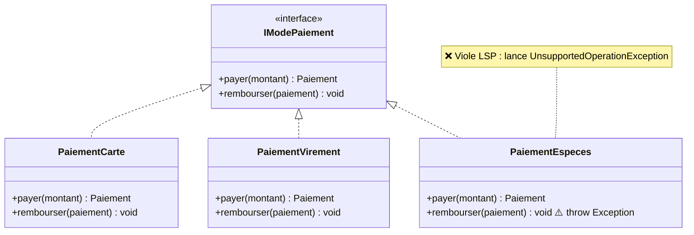
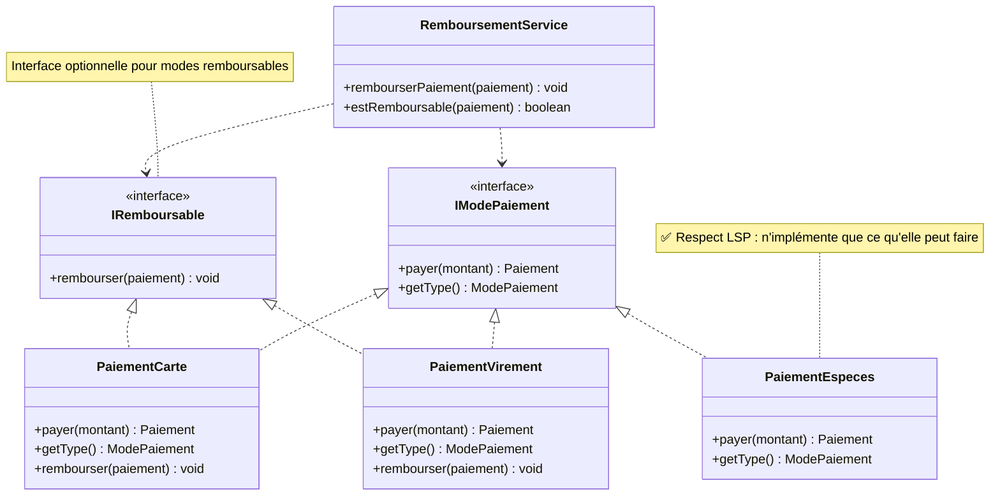
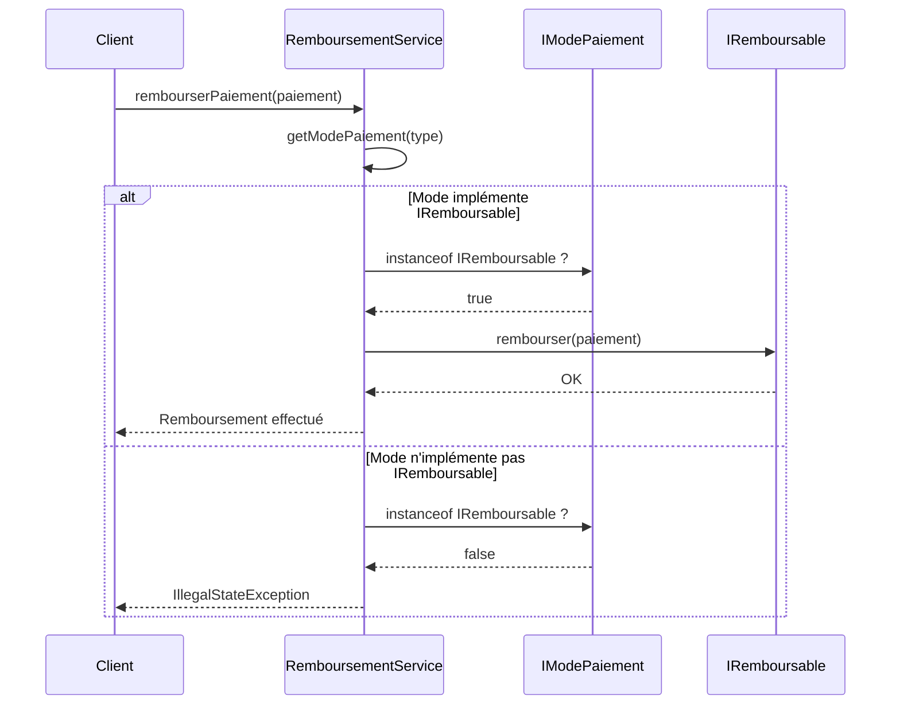

# Atelier 6 — Du code spaghetti au Clean Code
## Appliquer les principes SOLID

---

### Mission 3 — Le Remboursement

**Projet :** AutoLoc — Application de gestion d'une agence de location de véhicules  
**Principe étudié :** LSP (Liskov Substitution Principle)  
**Technologie :** Java 17, Spring Boot 4.0.8  
**Membres de l'équipe :**
- [Nom Étudiant 1]
- [Nom Étudiant 2]

**Établissement :** [À compléter]  
**Date de remise :** [À compléter]

---

## Table des matières

1. [Présentation du contexte](#1-présentation-du-contexte)
2. [Analyse du problème initial](#2-analyse-du-problème-initial)
3. [Principe SOLID appliqué](#3-principe-solid-appliqué)
4. [Proposition de solution](#4-proposition-de-solution)
5. [Schéma d'architecture](#5-schéma-darchitecture)
6. [Proposition de code Java](#6-proposition-de-code-java)
7. [Comparaison avant/après](#7-comparaison-avantaprès)
8. [Limites et décisions de conception](#8-limites-et-décisions-de-conception)
9. [Prompts de découverte](#9-prompts-de-découverte)
10. [Conclusion](#10-conclusion)
11. [Répartition du travail](#11-répartition-du-travail)

---

## 1. Présentation du contexte

### 1.1 Le projet AutoLoc

AutoLoc est une application de gestion d'une agence de location de véhicules développée en Java avec le framework Spring Boot. L'application permet de gérer l'ensemble des opérations liées à la location : réservations, contrats, paiements, et maintenance des véhicules.

### 1.2 Le contexte métier

L'agence AutoLoc accepte trois modes de paiement pour ses locations :
- **Paiement par CARTE bancaire**
- **Paiement par VIREMENT bancaire**
- **Paiement en ESPÈCES** (cash)

### 1.3 Le problème du remboursement

Lorsqu'un client annule sa réservation, l'agence doit le rembourser. Cependant, tous les modes de paiement ne peuvent pas être remboursés de la même manière :

| Mode de paiement | Remboursable ? | Méthode de remboursement |
|------------------|----------------|--------------------------|
| **CARTE** | ✅ Oui | Crédit sur la carte bancaire (3-5 jours) |
| **VIREMENT** | ✅ Oui | Virement de retour (3-5 jours) |
| **ESPÈCES** | ❌ Non | Impossible de rembourser du cash |

**Règle métier :** On ne rembourse pas les paiements effectués en espèces, car il est logistiquement impossible de restituer du cash de manière traçable et sécurisée.

---

## 2. Analyse du problème initial

### 2.1 La proposition du stagiaire

Un stagiaire a proposé la solution suivante :

```java
public interface IModePaiement {
    Paiement payer(double montant);
    void rembourser(Paiement paiement);   // pour tous les modes
}

// Implémentation pour le paiement en espèces
public class PaiementEspeces implements IModePaiement {
    
    @Override
    public Paiement payer(double montant) {
        // ... logique de paiement en espèces
    }
    
    @Override
    public void rembourser(Paiement paiement) {
        throw new UnsupportedOperationException("impossible");
    }
}
```

### 2.2 Analyse critique de cette solution

#### 2.2.1 Le problème fondamental

Cette solution **viole le principe LSP (Liskov Substitution Principle)**.

**Pourquoi ?**

1. **L'interface promet une fonctionnalité universelle**
   - `IModePaiement` déclare la méthode `rembourser()` pour **tous** les modes de paiement
   - Cela signifie que tout mode de paiement **devrait** pouvoir être remboursé

2. **L'implémentation brise cette promesse**
   - `PaiementEspeces` implémente `IModePaiement`
   - Mais elle lance une exception à l'exécution pour `rembourser()`
   - Elle ne respecte donc pas le contrat de l'interface

3. **Conséquence : comportement inattendu**
   - Un code client qui utilise `IModePaiement` s'attend à pouvoir appeler `rembourser()` sans exception
   - Avec `PaiementEspeces`, il reçoit une exception surprise à l'exécution
   - Cela viole le principe de substitution de Liskov

#### 2.2.2 Les conséquences concrètes

##### ❌ Pas de sécurité à la compilation

```java
IModePaiement modePaiement = obtenirModePaiement();
modePaiement.rembourser(paiement);  // ⚠️ Peut crasher si c'est du cash !
```

Le compilateur ne peut pas détecter le problème. L'erreur n'apparaît qu'à l'exécution.

##### ❌ Code défensif obligatoire

Le code client doit constamment vérifier le type de paiement avant d'appeler `rembourser()` :

```java
if (modePaiement instanceof PaiementEspeces) {
    throw new IllegalStateException("Impossible de rembourser du cash");
} else {
    modePaiement.rembourser(paiement);
}
```

Cette vérification manuelle détruit l'intérêt du polymorphisme.

##### ❌ Tests fragiles

Les tests doivent vérifier que l'exception `UnsupportedOperationException` est bien lancée pour les espèces, ce qui complique inutilement la couverture de tests.

##### ❌ Mauvaise expérience développeur

Un développeur qui découvre le code ne peut pas deviner, à la lecture de l'interface, que certaines implémentations lancent des exceptions. Il doit lire toute la documentation ou découvrir le problème par un crash.

#### 2.2.3 Pourquoi c'est une violation de LSP

Le principe de Liskov stipule :

> « Les objets d'une classe dérivée doivent pouvoir remplacer les objets de la classe de base sans altérer le bon fonctionnement du programme. »

Ici, `PaiementEspeces` ne peut **pas** remplacer `IModePaiement` de manière transparente :
- Si je manipule une référence `IModePaiement`, je m'attends à pouvoir appeler `rembourser()`
- Mais si cette référence pointe vers `PaiementEspeces`, l'appel échoue

→ **Violation du contrat, donc violation de LSP.**

### 2.3 Symptômes typiques d'une violation de LSP

Les signes qui indiquent une violation de LSP :
- ✅ **Présent ici :** Lancer `UnsupportedOperationException` dans une méthode d'interface
- ✅ **Présent ici :** Utiliser `instanceof` pour vérifier le type avant d'appeler une méthode
- ✅ **Présent ici :** Avoir des méthodes "vides" ou "stub" dans certaines implémentations
- ❌ **Évité ici :** Retourner `null` ou des valeurs par défaut trompeuses

---

## 3. Principe SOLID appliqué

### 3.1 Définition du principe LSP

Le principe que nous appliquons pour résoudre ce problème est :

**LSP — Liskov Substitution Principle (Principe de substitution de Liskov)**

**Définition formelle :** « Les objets d'un programme doivent pouvoir être remplacés par des instances de leurs sous-types sans altérer la correction de ce programme. »

**Définition simple :** « Si une classe B hérite ou implémente une classe/interface A, alors je dois pouvoir remplacer A par B partout dans mon code sans que rien ne se casse. »

### 3.2 Origine et contexte

Ce principe a été énoncé par **Barbara Liskov** en 1987, informaticienne américaine et professeure au MIT. Elle a reçu le prix Turing en 2008 pour ses contributions à la théorie de la programmation.

Le principe LSP est l'un des cinq principes SOLID, introduits par Robert C. Martin pour améliorer la maintenabilité et la robustesse des systèmes orientés objet.

### 3.3 Explication avec une analogie

Imaginons un contrat de travail :
- **Contrat :** « Tous les employés peuvent travailler à distance »
- **Problème :** Un employé particulier refuse de travailler à distance et lance une exception quand on le lui demande
- **Conséquence :** Le contrat est mensonger, car il ne représente pas la réalité

**Solution LSP :**
- **Contrat général :** « Tous les employés peuvent travailler »
- **Contrat spécifique :** « Certains employés peuvent travailler à distance » (sous-interface)
- Les employés qui ne travaillent pas à distance n'implémentent pas le contrat spécifique

C'est exactement ce que nous appliquons avec les modes de paiement :
- **Contrat général :** `IModePaiement` (payer)
- **Contrat spécifique :** `IRemboursable` (rembourser)
- Les paiements en espèces n'implémentent que le contrat général

### 3.4 Application au cas AutoLoc

Dans notre cas, l'interface `IModePaiement` du stagiaire viole LSP car :

1. **Elle promet une capacité universelle** : tous les modes de paiement peuvent être remboursés
2. **Certaines implémentations brisent cette promesse** : `PaiementEspeces` lance une exception
3. **Le code client ne peut pas remplacer de manière sûre** : il doit vérifier le type avant d'appeler `rembourser()`

**Notre solution LSP :**
- Séparer les capacités en deux interfaces distinctes
- `IModePaiement` : capacité commune (payer)
- `IRemboursable` : capacité optionnelle (rembourser)
- Chaque classe implémente uniquement les interfaces correspondant à ses réelles capacités

### 3.5 Relation avec les autres principes SOLID

LSP est étroitement lié aux autres principes :

| Principe | Relation avec LSP |
|----------|-------------------|
| **SRP** | Une classe respectant SRP a plus de chances de respecter LSP (responsabilités claires) |
| **OCP** | LSP facilite l'extension sans modification (on ajoute de nouvelles implémentations sans casser l'existant) |
| **ISP** | LSP et ISP travaillent ensemble : ISP crée des interfaces cohérentes, LSP garantit qu'elles sont respectées |
| **DIP** | LSP rend la dépendance aux abstractions sûre (on peut remplacer les implémentations concrètes) |

### 3.6 Règles pratiques pour respecter LSP

Pour respecter LSP dans votre code :

1. **Ne lancez jamais `UnsupportedOperationException`** dans une méthode d'interface
2. **Ne retournez pas `null`** pour signifier "non supporté"
3. **Ne laissez pas de méthodes vides** (stub) dans vos implémentations
4. **Préférez plusieurs interfaces spécialisées** à une interface généraliste avec des méthodes optionnelles
5. **Utilisez `instanceof` uniquement pour ajouter des fonctionnalités**, jamais pour éviter des crashs
6. **Documentez les préconditions et postconditions** de vos méthodes et respectez-les

---

## 4. Proposition de solution

### 4.1 Approche de résolution

Pour respecter le principe LSP, nous proposons de **séparer les capacités en deux interfaces distinctes** :

1. **`IModePaiement`** : Interface de base contenant les opérations communes à **tous** les modes de paiement
2. **`IRemboursable`** : Interface spécialisée contenant les opérations de remboursement, implémentée **uniquement** par les modes de paiement remboursables

### 4.2 Architecture proposée

```
                    IModePaiement (base)
                         |
                    payer(montant)
                    getType()
                         |
        ┌────────────────┼────────────────┐
        |                |                |
   PaiementCarte  PaiementVirement  PaiementEspeces
        |                |                |
        └────────────────┘                |
                |                         |
         IRemboursable                    |
                |                         |
      rembourser(paiement)                |
                                          |
                            (N'implémente PAS IRemboursable)
```

### 4.3 Les deux interfaces

#### 4.3.1 IModePaiement (interface de base)

Cette interface contient **uniquement** les opérations que **tous** les modes de paiement peuvent effectuer :

```java
public interface IModePaiement {
    Paiement payer(BigDecimal montant);
    ModePaiement getType();
}
```

**Implémentée par :**
- ✅ `PaiementCarte`
- ✅ `PaiementVirement`
- ✅ `PaiementEspeces`

#### 4.3.2 IRemboursable (interface spécialisée)

Cette interface contient les opérations de remboursement, implémentée **uniquement** par les modes remboursables :

```java
public interface IRemboursable {
    void rembourser(Paiement paiement);
}
```

**Implémentée par :**
- ✅ `PaiementCarte`
- ✅ `PaiementVirement`
- ❌ **PAS** par `PaiementEspeces`

### 4.4 Les trois implémentations

#### 4.4.1 PaiementCarte

```java
@Component
public class PaiementCarte implements IModePaiement, IRemboursable {
    // Implémente payer() et rembourser()
}
```

**Capacités :**
- ✅ Peut effectuer des paiements
- ✅ Peut être remboursée

#### 4.4.2 PaiementVirement

```java
@Component
public class PaiementVirement implements IModePaiement, IRemboursable {
    // Implémente payer() et rembourser()
}
```

**Capacités :**
- ✅ Peut effectuer des paiements
- ✅ Peut être remboursée

#### 4.4.3 PaiementEspeces

```java
@Component
public class PaiementEspeces implements IModePaiement {
    // Implémente SEULEMENT payer()
    // PAS de méthode rembourser()
}
```

**Capacités :**
- ✅ Peut effectuer des paiements
- ❌ **Ne peut PAS** être remboursée (et le compilateur l'empêche)

### 4.5 Service de remboursement

Le service `RemboursementService` utilise les interfaces de manière sûre :

```java
@Service
public class RemboursementService {
    
    public void rembourserPaiement(Paiement paiement) {
        IModePaiement modePaiement = getModePaiement(paiement);
        
        // Vérification LSP-conforme avec instanceof
        if (modePaiement instanceof IRemboursable remboursable) {
            remboursable.rembourser(paiement);
        } else {
            throw new IllegalStateException(
                "Impossible de rembourser un paiement en " + 
                paiement.getModePaiement()
            );
        }
    }
    
    public boolean estRemboursable(Paiement paiement) {
        IModePaiement modePaiement = getModePaiement(paiement);
        return modePaiement instanceof IRemboursable;
    }
}
```

### 4.6 Avantages de cette solution

#### ✅ Sécurité à la compilation

Le compilateur **empêche** d'appeler `rembourser()` sur un paiement en espèces :

```java
PaiementEspeces especes = new PaiementEspeces();
especes.rembourser(paiement);  // ❌ ERREUR DE COMPILATION
```

#### ✅ Pas d'exceptions à l'exécution

Plus de `UnsupportedOperationException` surprise. Si le code compile, il fonctionne.

#### ✅ Code auto-documenté

Les interfaces expriment explicitement les capacités :
- `IModePaiement` → tous les modes peuvent payer
- `IRemboursable` → seuls certains modes peuvent être remboursés

#### ✅ Respect de LSP

Chaque classe peut être substituée à son interface sans problème :
- `PaiementCarte` peut remplacer `IModePaiement` ✅
- `PaiementCarte` peut remplacer `IRemboursable` ✅
- `PaiementEspeces` peut remplacer `IModePaiement` ✅
- `PaiementEspeces` **ne prétend pas** pouvoir remplacer `IRemboursable` ✅

#### ✅ Évolutivité

Ajouter un nouveau mode de paiement est simple :
- Implémente `IModePaiement` → mode de base
- Implémente aussi `IRemboursable` → mode remboursable
- Pas besoin de modifier le code existant

---

## 5. Schéma d'architecture

### 5.1 Architecture AVANT (violation de LSP)



**Problème :** `PaiementEspeces` implémente `rembourser()` mais lance une exception → violation de LSP.

### 5.2 Architecture APRÈS (respect de LSP)



**Solution :** `PaiementEspeces` n'implémente **pas** `IRemboursable` → respect de LSP.

### 5.3 Flux de remboursement



---

## 6. Proposition de code Java

### 6.1 Interface IModePaiement (base)

**Fichier :** `src/main/java/tn/esprit/sabeurarfaoui4cce11/service/paiement/IModePaiement.java`

```java
package tn.esprit.sabeurarfaoui4cce11.service.paiement;

import tn.esprit.sabeurarfaoui4cce11.domain.Paiement;
import java.math.BigDecimal;

/**
 * Interface de base pour tous les modes de paiement.
 * 
 * PRINCIPE LSP : Cette interface ne contient QUE les opérations communes
 * à TOUS les modes de paiement, sans exception.
 */
public interface IModePaiement {

    /**
     * Effectue un paiement pour un montant donné
     * 
     * @param montant Le montant à payer
     * @return L'objet Paiement créé
     */
    Paiement payer(BigDecimal montant);
    
    /**
     * Retourne le type de mode de paiement
     * 
     * @return Le type de paiement (CARTE, VIREMENT, ESPECES)
     */
    tn.esprit.sabeurarfaoui4cce11.domain.ModePaiement getType();
}
```

### 6.2 Interface IRemboursable (spécialisée)

**Fichier :** `src/main/java/tn/esprit/sabeurarfaoui4cce11/service/paiement/IRemboursable.java`

```java
package tn.esprit.sabeurarfaoui4cce11.service.paiement;

import tn.esprit.sabeurarfaoui4cce11.domain.Paiement;

/**
 * Interface pour les modes de paiement remboursables.
 * 
 * PRINCIPE LSP : Seuls les modes de paiement qui PEUVENT RÉELLEMENT
 * être remboursés implémentent cette interface.
 * 
 * Implémentée par :
 * - PaiementCarte ✅
 * - PaiementVirement ✅
 * 
 * NON implémentée par :
 * - PaiementEspeces ❌
 */
public interface IRemboursable {

    /**
     * Rembourse un paiement
     * 
     * @param paiement Le paiement à rembourser
     * @throws IllegalStateException Si le paiement a déjà été remboursé
     * @throws IllegalArgumentException Si le paiement est invalide
     */
    void rembourser(Paiement paiement);
}
```

### 6.3 PaiementCarte (remboursable)

**Fichier :** `src/main/java/tn/esprit/sabeurarfaoui4cce11/service/paiement/PaiementCarte.java`

```java
package tn.esprit.sabeurarfaoui4cce11.service.paiement;

import org.springframework.stereotype.Component;
import tn.esprit.sabeurarfaoui4cce11.domain.ModePaiement;
import tn.esprit.sabeurarfaoui4cce11.domain.Paiement;

import java.math.BigDecimal;
import java.time.LocalDate;

/**
 * Implémentation du mode de paiement par CARTE.
 * 
 * Cette classe implémente les deux interfaces :
 * - IModePaiement : car on peut payer par carte
 * - IRemboursable : car on peut rembourser un paiement par carte
 */
@Component
public class PaiementCarte implements IModePaiement, IRemboursable {

    @Override
    public Paiement payer(BigDecimal montant) {
        System.out.println("[CARTE] Débit de la carte : " + montant + " €");
        
        BigDecimal montantAvecFrais = montant.multiply(BigDecimal.valueOf(1.01));
        
        Paiement paiement = new Paiement();
        paiement.setMontant(montantAvecFrais);
        paiement.setDatePaiement(LocalDate.now());
        paiement.setModePaiement(ModePaiement.CARTE);
        
        return paiement;
    }

    @Override
    public void rembourser(Paiement paiement) {
        if (paiement == null || paiement.getMontant() == null) {
            throw new IllegalArgumentException("Paiement invalide");
        }
        
        if (paiement.getModePaiement() != ModePaiement.CARTE) {
            throw new IllegalArgumentException("Ce paiement n'est pas un paiement par carte");
        }
        
        System.out.println("[CARTE] Remboursement de " + paiement.getMontant() + " €");
    }

    @Override
    public ModePaiement getType() {
        return ModePaiement.CARTE;
    }
}
```

### 6.4 PaiementVirement (remboursable)

**Fichier :** `src/main/java/tn/esprit/sabeurarfaoui4cce11/service/paiement/PaiementVirement.java`

```java
package tn.esprit.sabeurarfaoui4cce11.service.paiement;

import org.springframework.stereotype.Component;
import tn.esprit.sabeurarfaoui4cce11.domain.ModePaiement;
import tn.esprit.sabeurarfaoui4cce11.domain.Paiement;

import java.math.BigDecimal;
import java.time.LocalDate;

/**
 * Implémentation du mode de paiement par VIREMENT.
 * 
 * Cette classe implémente les deux interfaces :
 * - IModePaiement : car on peut payer par virement
 * - IRemboursable : car on peut rembourser un paiement par virement
 */
@Component
public class PaiementVirement implements IModePaiement, IRemboursable {

    @Override
    public Paiement payer(BigDecimal montant) {
        System.out.println("[VIREMENT] Attente du virement : " + montant + " €");
        
        Paiement paiement = new Paiement();
        paiement.setMontant(montant);
        paiement.setDatePaiement(LocalDate.now());
        paiement.setModePaiement(ModePaiement.VIREMENT);
        
        return paiement;
    }

    @Override
    public void rembourser(Paiement paiement) {
        if (paiement == null || paiement.getMontant() == null) {
            throw new IllegalArgumentException("Paiement invalide");
        }
        
        if (paiement.getModePaiement() != ModePaiement.VIREMENT) {
            throw new IllegalArgumentException("Ce paiement n'est pas un paiement par virement");
        }
        
        System.out.println("[VIREMENT] Remboursement de " + paiement.getMontant() + " €");
    }

    @Override
    public ModePaiement getType() {
        return ModePaiement.VIREMENT;
    }
}
```

### 6.5 PaiementEspeces (NON remboursable)

**Fichier :** `src/main/java/tn/esprit/sabeurarfaoui4cce11/service/paiement/PaiementEspeces.java`

```java
package tn.esprit.sabeurarfaoui4cce11.service.paiement;

import org.springframework.stereotype.Component;
import tn.esprit.sabeurarfaoui4cce11.domain.ModePaiement;
import tn.esprit.sabeurarfaoui4cce11.domain.Paiement;

import java.math.BigDecimal;
import java.time.LocalDate;

/**
 * Implémentation du mode de paiement en ESPÈCES.
 * 
 * ⚠️ IMPORTANT : Cette classe implémente UNIQUEMENT IModePaiement.
 * Elle N'implémente PAS IRemboursable car il est impossible de rembourser du cash.
 * 
 * PRINCIPE LSP RESPECTÉ :
 * - ✅ PAS d'exception UnsupportedOperationException
 * - ✅ Le compilateur EMPÊCHE d'appeler rembourser() sur cette classe
 * - ✅ Le code client ne peut pas violer le contrat
 */
@Component
public class PaiementEspeces implements IModePaiement {

    @Override
    public Paiement payer(BigDecimal montant) {
        System.out.println("[ESPECES] Encaissement : " + montant + " €");
        
        Paiement paiement = new Paiement();
        paiement.setMontant(montant);
        paiement.setDatePaiement(LocalDate.now());
        paiement.setModePaiement(ModePaiement.ESPECES);
        
        return paiement;
    }

    @Override
    public ModePaiement getType() {
        return ModePaiement.ESPECES;
    }
}
```

### 6.6 RemboursementService

**Fichier :** `src/main/java/tn/esprit/sabeurarfaoui4cce11/service/paiement/RemboursementService.java`

```java
package tn.esprit.sabeurarfaoui4cce11.service.paiement;

import org.springframework.beans.factory.annotation.Autowired;
import org.springframework.stereotype.Service;
import tn.esprit.sabeurarfaoui4cce11.domain.ModePaiement;
import tn.esprit.sabeurarfaoui4cce11.domain.Paiement;

import java.util.Map;

/**
 * Service de gestion des remboursements.
 * 
 * Ce service utilise les interfaces IModePaiement et IRemboursable
 * de manière sûre et conforme au principe LSP.
 */
@Service
public class RemboursementService {

    private final Map<ModePaiement, IModePaiement> modesPaiement;

    @Autowired
    public RemboursementService(PaiementCarte carte, 
                                PaiementVirement virement, 
                                PaiementEspeces especes) {
        this.modesPaiement = Map.of(
            ModePaiement.CARTE, carte,
            ModePaiement.VIREMENT, virement,
            ModePaiement.ESPECES, especes
        );
    }

    /**
     * Rembourse un paiement si c'est possible
     */
    public void rembourserPaiement(Paiement paiement) {
        if (paiement == null || paiement.getModePaiement() == null) {
            throw new IllegalArgumentException("Paiement invalide");
        }

        IModePaiement modePaiement = modesPaiement.get(paiement.getModePaiement());
        
        // Vérification LSP-conforme
        if (modePaiement instanceof IRemboursable remboursable) {
            remboursable.rembourser(paiement);
        } else {
            throw new IllegalStateException(
                "Impossible de rembourser un paiement en " + 
                paiement.getModePaiement()
            );
        }
    }

    /**
     * Vérifie si un paiement peut être remboursé
     */
    public boolean estRemboursable(Paiement paiement) {
        if (paiement == null || paiement.getModePaiement() == null) {
            return false;
        }

        IModePaiement modePaiement = modesPaiement.get(paiement.getModePaiement());
        return modePaiement instanceof IRemboursable;
    }
}
```

### 6.7 Organisation des fichiers

```
src/main/java/tn/esprit/sabeurarfaoui4cce11/
├── service/
│   └── paiement/                    (nouveau package pour Mission 3)
│       ├── IModePaiement.java       (interface de base)
│       ├── IRemboursable.java       (interface spécialisée)
│       ├── PaiementCarte.java       (implémente les 2)
│       ├── PaiementVirement.java    (implémente les 2)
│       ├── PaiementEspeces.java     (implémente seulement IModePaiement)
│       └── RemboursementService.java (service de remboursement)
```

---

## 7. Comparaison avant/après

### 7.1 Tableau comparatif

| Critère | AVANT (stagiaire) | APRÈS (solution LSP) |
|---------|-------------------|----------------------|
| **Sécurité compilation** | ❌ Pas de vérification | ✅ Le compilateur empêche les erreurs |
| **Exceptions runtime** | ❌ UnsupportedOperationException | ✅ Aucune exception surprise |
| **Respect de LSP** | ❌ Violation claire | ✅ Respect total |
| **Code défensif** | ❌ `instanceof` obligatoire | ✅ `instanceof` pour ajouter des capacités |
| **Clarté du contrat** | ❌ Interface mensongère | ✅ Interfaces explicites |
| **Maintenabilité** | ❌ Fragile | ✅ Robuste |
| **Tests** | ❌ Doivent tester l'exception | ✅ Tests simples et clairs |
| **Documentation** | ❌ Nécessite doc externe | ✅ Code auto-documenté |

### 7.2 Exemple de code client

#### ❌ AVANT (solution du stagiaire)

```java
public void annulerReservation(Reservation reservation) {
    for (Paiement paiement : reservation.getPaiements()) {
        IModePaiement mode = obtenirModePaiement(paiement);
        
        // Code défensif OBLIGATOIRE
        if (mode instanceof PaiementEspeces) {
            System.out.println("Impossible de rembourser du cash");
        } else {
            try {
                mode.rembourser(paiement);  // Peut crasher !
            } catch (UnsupportedOperationException e) {
                System.out.println("Remboursement non supporté");
            }
        }
    }
}
```

**Problèmes :**
- ❌ Obligation de vérifier avec `instanceof`
- ❌ Obligation d'attraper l'exception
- ❌ Code verbeux et fragile
- ❌ Violation de LSP : on ne peut pas utiliser `IModePaiement` de manière transparente

#### ✅ APRÈS (solution LSP)

```java
public void annulerReservation(Reservation reservation) {
    for (Paiement paiement : reservation.getPaiements()) {
        if (remboursementService.estRemboursable(paiement)) {
            remboursementService.rembourserPaiement(paiement);
        } else {
            System.out.println("Paiement non remboursable : " + 
                             paiement.getModePaiement());
        }
    }
}
```

**Avantages :**
- ✅ Code simple et lisible
- ✅ Pas d'exception à gérer
- ✅ Méthode `estRemboursable()` exprime clairement l'intention
- ✅ Respect de LSP : chaque interface est utilisée correctement

### 7.3 Ajout d'un nouveau mode de paiement

#### Scénario : Ajout de « Paiement par portefeuille électronique » (WALLET)

##### ❌ AVANT

```java
public class PaiementWallet implements IModePaiement {
    
    @Override
    public Paiement payer(double montant) {
        // ... paiement via wallet
    }
    
    @Override
    public void rembourser(Paiement paiement) {
        // ⚠️ Le wallet est remboursable, donc on implémente
        // Mais si demain il devient non-remboursable ?
        // On devra lancer une exception → violation de LSP
    }
}
```

**Problème :** On est **obligé** d'implémenter `rembourser()`, même si demain ce n'est plus possible.

##### ✅ APRÈS

```java
@Component
public class PaiementWallet implements IModePaiement, IRemboursable {
    
    @Override
    public Paiement payer(BigDecimal montant) {
        // ... paiement via wallet
    }
    
    @Override
    public void rembourser(Paiement paiement) {
        // ... remboursement via wallet
    }
    
    @Override
    public ModePaiement getType() {
        return ModePaiement.WALLET;
    }
}
```

**Si demain le wallet n'est plus remboursable :**

```java
@Component
public class PaiementWallet implements IModePaiement {
    // On retire simplement "IRemboursable"
    // Pas besoin de modifier le reste du code !
}
```

**Avantage :** Flexibilité totale, pas de code à casser.

---

## 8. Limites et décisions de conception

### 8.1 Utilisation de `instanceof`

**Question :** N'est-ce pas un anti-pattern d'utiliser `instanceof` ?

**Réponse :** Cela dépend du contexte.

#### ❌ Mauvaise utilisation de `instanceof` (violation de LSP)

```java
// Anti-pattern : vérifier le type pour ÉVITER un crash
if (modePaiement instanceof PaiementEspeces) {
    // Ne rien faire car ça va crasher
} else {
    modePaiement.rembourser(paiement);
}
```

C'est un **symptôme de violation de LSP**. Si vous devez vérifier le type concret pour éviter un crash, c'est que votre hiérarchie est mal conçue.

#### ✅ Bonne utilisation de `instanceof` (respect de LSP)

```java
// Pattern correct : vérifier une CAPACITÉ optionnelle
if (modePaiement instanceof IRemboursable remboursable) {
    remboursable.rembourser(paiement);  // Ajoute une fonctionnalité
} else {
    System.out.println("Mode non remboursable");  // Gestion normale
}
```

C'est **conforme à LSP**. On vérifie si l'objet possède une **capacité supplémentaire**, pas pour éviter un crash. C'est l'équivalent du pattern Visitor ou Strategy.

### 8.2 Alternative sans `instanceof` : Pattern Strategy complet

Si on veut éviter complètement `instanceof`, on peut utiliser un pattern plus complexe :

```java
public interface IModePaiement {
    Paiement payer(BigDecimal montant);
    ModePaiement getType();
    PolitiqueRemboursement getPolitiqueRemboursement();
}

public interface PolitiqueRemboursement {
    boolean estRemboursable();
    void rembourser(Paiement paiement);
}

public class RemboursablePolitique implements PolitiqueRemboursement {
    public boolean estRemboursable() { return true; }
    public void rembourser(Paiement p) { /* remboursement */ }
}

public class NonRemboursablePolitique implements PolitiqueRemboursement {
    public boolean estRemboursable() { return false; }
    public void rembourser(Paiement p) { 
        throw new IllegalStateException("Non remboursable");
    }
}
```

**Notre choix :** Nous avons préféré la solution avec `IRemboursable` car :
- ✅ Plus simple et directe
- ✅ Moins de classes à créer
- ✅ Plus idiomatique en Java
- ✅ `instanceof` est acceptable ici (vérification de capacité)

### 8.3 Pourquoi ne pas utiliser une classe abstraite ?

**Question :** Pourquoi deux interfaces au lieu d'une classe abstraite avec des méthodes abstraites ?

**Réponse :** Les interfaces offrent plus de flexibilité.

#### Avec classe abstraite

```java
abstract class ModePaiement {
    abstract Paiement payer(BigDecimal montant);
    
    // Méthode par défaut qui lance une exception
    void rembourser(Paiement paiement) {
        throw new UnsupportedOperationException();
    }
}

class PaiementCarte extends ModePaiement {
    // Override rembourser() pour le rendre fonctionnel
}

class PaiementEspeces extends ModePaiement {
    // Ne surcharge pas rembourser() → exception
}
```

**Problème :** On retombe dans la violation de LSP (exception par défaut).

#### Avec interfaces (notre solution)

- ✅ Pas d'héritage imposé
- ✅ Une classe peut implémenter plusieurs interfaces
- ✅ Respect total de LSP
- ✅ Flexibilité maximale

### 8.4 Gestion des états et transactions

**Limitation actuelle :** Notre solution ne gère pas :
- Les remboursements partiels
- L'historique des remboursements
- La gestion transactionnelle (rollback si échec)
- Les statuts de paiement (ENCAISSE, REMBOURSE, EN_ATTENTE)

**Évolution future :** Pour un système de production, il faudrait ajouter :

```java
@Entity
public class Paiement {
    // ... attributs existants
    
    @Enumerated(EnumType.STRING)
    private StatutPaiement statut;  // ENCAISSE, REMBOURSE, etc.
    
    private BigDecimal montantRembourse;
    private LocalDate dateRemboursement;
}
```

Mais cela sort du scope de la Mission 3, qui se concentre sur le principe LSP.

### 8.5 Tests unitaires

Notre solution facilite les tests :

```java
@Test
public void testRemboursementCarte() {
    PaiementCarte carte = new PaiementCarte();
    Paiement paiement = carte.payer(BigDecimal.valueOf(100));
    
    // Pas besoin de try-catch
    carte.rembourser(paiement);
    
    // Assertion simple
    assertTrue(true);  // Si on arrive ici, le remboursement a marché
}

@Test
public void testEspecesNonRemboursable() {
    PaiementEspeces especes = new PaiementEspeces();
    
    // Pas de méthode rembourser() disponible
    // Le test ne compile même pas si on essaie
    
    // Vérification avec le service
    Paiement paiement = especes.payer(BigDecimal.valueOf(100));
    assertFalse(remboursementService.estRemboursable(paiement));
}
```

---

## 9. Prompts de découverte

Cette section documente les questions que nous avons posées à un assistant d'IA pendant notre phase de recherche.

| Prompt (tel quel) | Ce que nous en avons retenu | Ce que nous avons corrigé ou écarté, et pourquoi |
|-------------------|----------------------------|------------------------------------------------|
| [À compléter par les étudiants] | [À compléter] | [À compléter] |
| [À compléter par les étudiants] | [À compléter] | [À compléter] |
| [À compléter par les étudiants] | [À compléter] | [À compléter] |

**Note :** Cette section doit être complétée par les étudiants avec leurs prompts réels.

---

## 10. Conclusion

### 10.1 Résumé du problème

La solution initiale du stagiaire violait le principe LSP en forçant tous les modes de paiement à implémenter une méthode `rembourser()`, même ceux qui ne peuvent pas être remboursés. Cette violation se manifestait par une exception `UnsupportedOperationException` lancée à l'exécution pour les paiements en espèces.

### 10.2 Application du principe LSP

Nous avons appliqué le **principe LSP (Liskov Substitution Principle)** en :
1. Séparant les capacités en deux interfaces distinctes
2. Créant `IRemboursable` pour les modes remboursables uniquement
3. Permettant au compilateur de garantir la sécurité du code

### 10.3 Bénéfices concrets

Notre solution apporte :
- ✅ **Sécurité à la compilation** : impossible d'appeler `rembourser()` sur un mode non-remboursable
- ✅ **Pas d'exceptions surprises** : plus de `UnsupportedOperationException` à l'exécution
- ✅ **Code auto-documenté** : les interfaces expriment clairement les capacités
- ✅ **Évolutivité** : facile d'ajouter de nouveaux modes de paiement
- ✅ **Testabilité** : tests unitaires simples et robustes

### 10.4 Leçon apprise

**Le principe LSP nous enseigne :** Une interface ne doit promettre que ce que **toutes** ses implémentations peuvent **réellement** tenir.

Si certaines implémentations ne peuvent pas respecter une partie du contrat, c'est que l'interface est trop large et doit être divisée.

### 10.5 Application aux autres projets

Ce principe s'applique partout où vous avez :
- Des hiérarchies de classes avec des capacités optionnelles
- Des méthodes qui lancent `UnsupportedOperationException`
- Du code défensif avec `instanceof` pour éviter des crashs
- Des interfaces "à tiroirs" avec des méthodes inutilisées

**Règle d'or :** Si vous devez vérifier le type concret avant d'appeler une méthode, vous violez probablement LSP.

---

## 11. Répartition du travail

### Étudiant 1 : [Nom à compléter]

**Tâches réalisées :**
- [À compléter]
- [À compléter]

**Temps estimé :** [À compléter] heures

### Étudiant 2 : [Nom à compléter]

**Tâches réalisées :**
- [À compléter]
- [À compléter]

**Temps estimé :** [À compléter] heures

### Travail collaboratif

**Tâches réalisées en binôme :**
- [À compléter]
- [À compléter]

---

## Annexes

### Fichiers du projet

Tous les fichiers Java créés sont disponibles dans :

**Package :** `src/main/java/tn/esprit/sabeurarfaoui4cce11/service/paiement/`

1. `IModePaiement.java` - Interface de base
2. `IRemboursable.java` - Interface spécialisée
3. `PaiementCarte.java` - Implémentation remboursable
4. `PaiementVirement.java` - Implémentation remboursable
5. `PaiementEspeces.java` - Implémentation NON remboursable
6. `RemboursementService.java` - Service de remboursement

### Références

- Robert C. Martin, *Clean Architecture*, 2017
- Barbara Liskov, *Data Abstraction and Hierarchy*, 1987
- Documentation Spring Boot : https://spring.io/projects/spring-boot
- Principes SOLID : https://en.wikipedia.org/wiki/SOLID

---

**Fin du rapport**

---

*Document généré dans le cadre de l'Atelier 6 — Mission 3  
Projet AutoLoc — Principe LSP*
